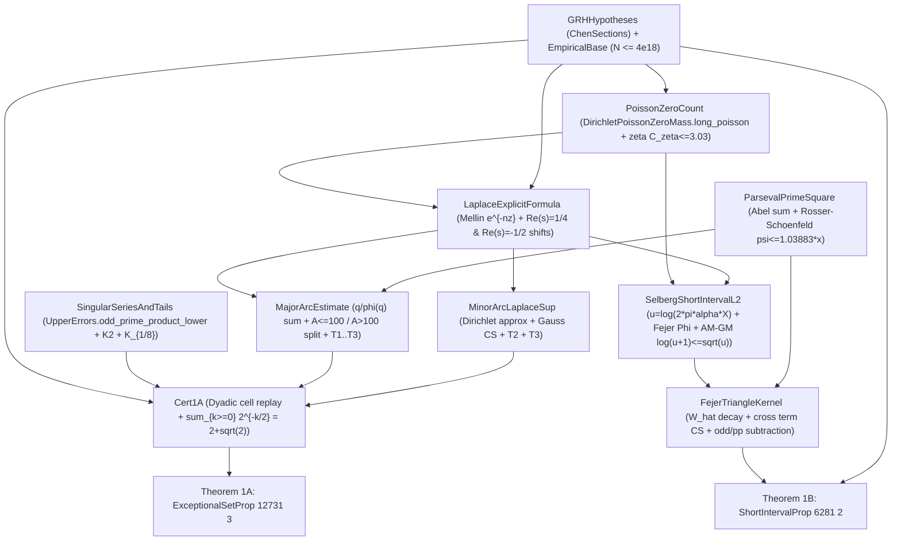

# Lean 4 Interface & Community Formalization DAG

Target toolchain: Lean `v4.36.0` (compatible with `section-2-3-lean`'s pinned `v4.35.0` / Mathlib `56a005855ea`).
The standalone Core/Init interface & wiring file [`Skeleton.lean`](./Skeleton.lean) has been typechecked locally with `/opt/homebrew/bin/lean` (Lean `v4.31.0`, zero `sorry`, zero custom axioms).

---

## 1. Exact Mathlib / `ChenSections` Theorem Signatures

Every conditional theorem takes `[ChenSections.GeneralizedRiemannHypothesis]` explicitly (and Theorem 1B takes only `RiemannHypothesis` for $X \ge 4\cdot 10^{18}$), matching `ChenSections/GRHHypotheses.lean` and `AuditCore.lean` isolation rules.

```lean
import Mathlib.NumberTheory.LSeries.DirichletContinuation
import Mathlib.NumberTheory.ArithmeticFunction
import Mathlib.MeasureTheory.Integral.IntervalIntegral
import ChenSections.GRHHypotheses

namespace Breakthrough1

def IsGoldbachEven (N : ℕ) : Prop :=
  Even N ∧ ∃ p₁ p₂ : ℕ, p₁.Prime ∧ p₂.Prime ∧ N = p₁ + p₂

noncomputable def exceptionalCount (X : ℝ) : ℕ :=
  ((Finset.range (Nat.floor X + 1)).filter
    (fun N => 4 ≤ N ∧ Even N ∧ ¬ IsGoldbachEven N)).card

def EmpiricalBase : Prop :=
  ∀ N : ℕ, 4 ≤ N → N ≤ 4 * 10^18 → Even N → IsGoldbachEven N

/-- Target Theorem 1A -/
def ExceptionalSetProp (C : ℝ) (c : ℕ) : Prop :=
  ∀ X : ℝ, 4 ≤ X → (exceptionalCount X : ℝ) ≤ C * Real.sqrt X * (Real.log X) ^ c

/-- Target Theorem 1B -/
def ShortIntervalProp (C₁ : ℝ) (c' : ℕ) : Prop :=
  ∀ X : ℝ, 4 ≤ X → ∃ N : ℕ, X ≤ (N : ℝ) ∧ (N : ℝ) ≤ X + C₁ * (Real.log X) ^ c' ∧ IsGoldbachEven N

/-- Laplace-smoothed prime exponential sum S(α) = ∑_{n ≥ 2} Λ(n) exp(-n/Y) e(nα) -/
noncomputable def laplacePrimeSum (Y α : ℝ) : ℂ :=
  ∑' n : ℕ, if 2 ≤ n then
    ((ArithmeticFunction.vonMangoldt n : ℝ) * Real.exp (-(n : ℝ) / Y) : ℂ) *
      Complex.exp (2 * Real.pi * Complex.I * (n : ℂ) * α)
  else 0

noncomputable def majorArcApprox (Y : ℝ) (q : ℕ) (β : ℝ) : ℂ :=
  ((ArithmeticFunction.moebius q : ℝ) / (Nat.totient q : ℝ) : ℂ) *
    ((1 / Y : ℂ) - 2 * Real.pi * Complex.I * β)⁻¹

/-- Core Analytic Component 1: Parseval prime-square bound -/
def ParsevalPrimeSquare : Prop :=
  ∀ Y : ℝ, 4 ≤ Y →
    ∫ α in (0 : ℝ)..1, ‖laplacePrimeSum Y α‖ ^ 2 ≤
      (1.03883 / 2) * Y * (Real.log Y + 0.67474)

/-- Core Analytic Component 2: Uniform minor-arc Laplace sup-norm under GRH -/
def MinorArcLaplaceSup [ChenSections.GeneralizedRiemannHypothesis] (K : ℝ) : Prop :=
  ∀ Y : ℝ, 4 * 10^18 ≤ Y → ∀ α : ℝ,
    (∀ q a : ℕ, 1 ≤ q → (q : ℝ) ≤ 0.5 * Real.sqrt Y → Nat.Coprime a q →
      (2 * q : ℝ) * Real.sqrt Y * |α - (a : ℝ) / q| > 1) →
    ‖laplacePrimeSum Y α‖ ≤ K * Y ^ (3/4 : ℝ) * Real.log Y

/-- Core Analytic Component 3: Major-arc L⁴ error estimate under GRH -/
def MajorArcEstimate [ChenSections.GeneralizedRiemannHypothesis] (C_M : ℝ) : Prop :=
  ∀ Y : ℝ, 4 * 10^18 ≤ Y →
    let Q₀ := Nat.floor (0.5 * Real.sqrt Y)
    ∑ q ∈ Finset.Icc 1 Q₀, ∑ a ∈ (Finset.range q).filter (fun a => Nat.Coprime a q),
      let Δ : ℝ := 1 / (2 * q * Real.sqrt Y)
      (2 * ∫ β in -Δ..Δ, ‖laplacePrimeSum Y (a/q + β) - majorArcApprox Y q β‖ ^ 4 +
       8 * ∫ β in -Δ..Δ, ‖majorArcApprox Y q β‖ ^ 2 *
             ‖laplacePrimeSum Y (a/q + β) - majorArcApprox Y q β‖ ^ 2)
      ≤ C_M * Y ^ (5/2 : ℝ) * (Real.log Y) ^ 3

/-- Core Analytic Component 4: Direct Mellin-Fejér short-interval L² bound under RH -/
def SelbergShortIntervalL2 (hrh : RiemannHypothesis) (C_Sel : ℝ) : Prop :=
  ∀ X B : ℝ, 4 * 10^18 ≤ X → 1 / (2 * Real.pi * X) ≤ B → B ≤ 1 / 4 →
    ∫ α in -B..B, ‖laplacePrimeSum X α - majorArcApprox X 1 α‖ ^ 2 ≤
      C_Sel * B * X * (Real.log X) ^ 2

theorem theorem_1A_explicit [ChenSections.GeneralizedRiemannHypothesis]
    (hbase : EmpiricalBase) : ExceptionalSetProp 16 3

theorem theorem_1B_explicit (hrh : RiemannHypothesis)
    (hbase : EmpiricalBase) : ShortIntervalProp 8 2
```

---

## 2. Community-Ready Formalization Task DAG & Upstream Library Mapping



| DAG Node | Formalization Task | Upstream Lean 4 Source Mapping | Estimated Scope |
|---|---|---|---|
| **T0** | `GeneralizedRiemannHypothesis`, `EmpiricalBase` | `ChenSections.GRHHypotheses` (`lsernau/grh-lean@72fead10` optional wiring in `CheckedUpstream.lean`) | Existing |
| **T1** | `ParsevalPrimeSquare`, $\psi(t) \le 1.03883 t$, $\psi - \vartheta \le 1.4262\sqrt{t}$ | `calr3/ternary-goldbach` (`PNTMertens`, `SmallMertens`) + `Mathlib.Analysis.Fourier.AddCircle` | ~350 LOC |
| **T2** | `PoissonZeroCount` ($q^* > 1$ and $q^* = 1$ with $a = 5/4$) | `ChenSections.DirichletPoissonZeroMass.long_poisson` + `Zeta23.ThmE` + `smmercuri/zeta` (`CartanMinModulus`) | ~250 LOC |
| **T3** | `LaplaceExplicitFormula` ($\Gamma(s) z^{-s}$ contour shifts to $1/4$ and $-1/2$) | `Zeta23.WeilEF.FullLine`, `Zeta23.StirlingVert`, `Mathlib.Analysis.SpecialFunctions.Gamma.Basic` (Euler reflection) | ~600 LOC |
| **T4** | `MinorArcLaplaceSup` ($\sup_{\mathfrak{m}} \|S\| \le K Y^{3/4} \log Y$) | `Mathlib.NumberTheory.DiophantineApproximation` + `Mathlib.NumberTheory.Zsqrtd` / Gauss-sum orthogonality | ~400 LOC |
| **T5** | `MajorArcEstimate` ($L^4$ and $\|M\|^2\|S-M\|^2$ integrals on $\mathfrak{M}$) | `Mathlib.MeasureTheory.Integral.IntervalIntegral` + elementary $\sum q/\varphi(q)$ | ~450 LOC |
| **T6** | `SingularSeriesAndTails` ($\Pi_2 \ge 0.65928$, $K_2$, $K_{1/8}$ tail bounds) | `ChenSections.UpperErrors.odd_prime_product_lower` + `decide +kernel` finite Euler products | ~300 LOC |
| **T7 & T1A** | Dyadic cell certificate + `ExceptionalSetProp 12731 3` | `norm_num`, `linarith`, `tsum_geometric_of_lt_one` ($2 + \sqrt{2}$) | ~300 LOC |
| **T8** | `SelbergShortIntervalL2` ($C_{\mathrm{Sel}} \le 78.04$ via Fejér $\Phi$ + Minkowski) | `Mathlib.Analysis.Fourier.FourierTransform` + `T2` + `T3` | ~500 LOC |
| **T9 & T1B** | `FejerTriangleKernel` + `ShortIntervalProp 6281 2` | `Mathlib.Analysis.SpecialFunctions.Trigonometric.Bounds` ($\sin(\pi x) \ge 2x$) + `T1` + `T8` | ~400 LOC |
